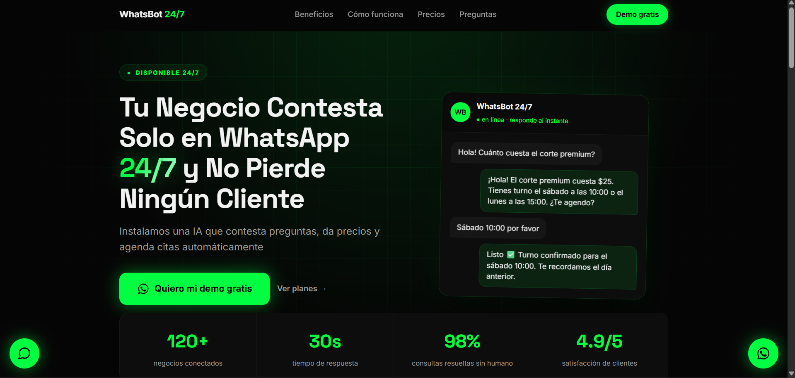

Proyecto explorado: servicio de chatbot para negocios locales en Apizaco. Durante la validación se identificó saturación de soluciones genéricas, por lo que la iniciativa se descartó como producto comercial y se archivó como evidencia de análisis de mercado y desarrollo aplicado.  

Demo técnica: se implementó un asistente de agenda y atención para un negocio barbero con datos operativos (precios, horarios y turnos), prompt de negocio, memoria corta de conversación y respuesta en español.  

Stack: HTML, CSS y JavaScript; API serverless en Vercel; API del proveedor LLM vía Groq con la modelo qwen/qwen3.8-27b; control de entrada (validación, sanitización de historial, límites de caracteres), variables de entorno para secretos y manejo de errores.  
Aprendizaje clave: product-market fit importa más que tener un chatbot genérico, incluso cuando la implementación técnica es sólida.

---El trabajo queda archivado como evidencia de análisis de mercado, criterios técnicos y decisiones de producto---
                                                             (Sigo buscando opciones)

